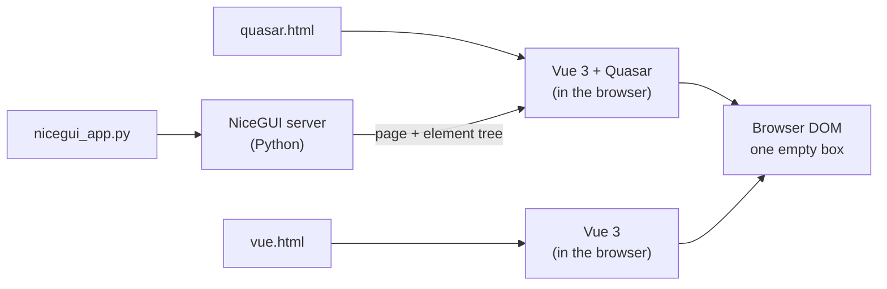

# How each column reaches the browser

All three files end as the same page, but they take different roads.
NiceGUI is the only one with a server: your Python runs there, and the browser gets the page from it.

