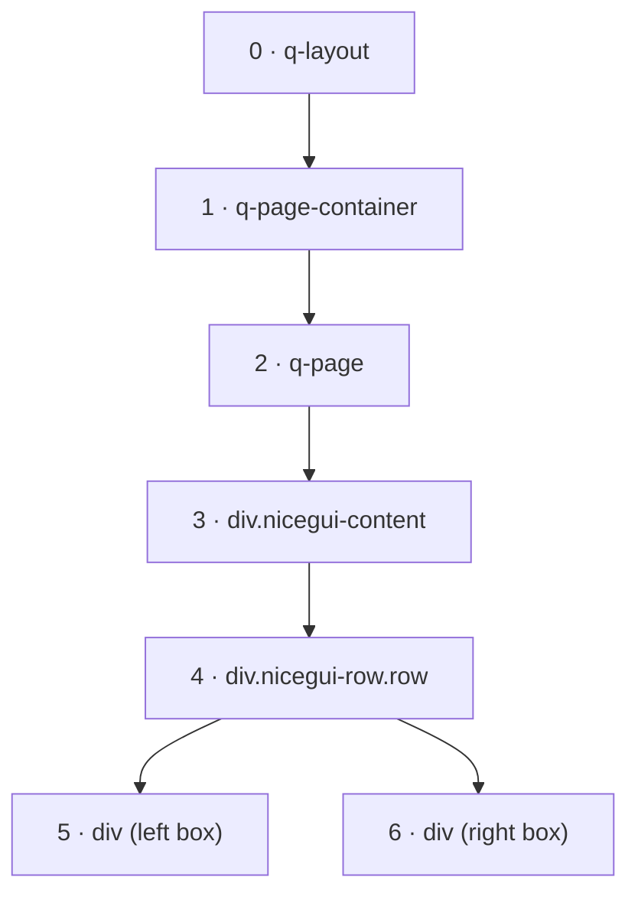

# What NiceGUI sends to the browser

This is the tree NiceGUI 4.0.0 sent for the NiceGUI column, taken from a real run (empty fields left
out). It is one flat list, numbered: `children` holds the numbers of the child nodes, not the nodes
themselves.

```json title="the element tree, as NiceGUI sends it"
{
  "0": {"tag": "q-layout", "class": ["nicegui-layout"], "props": {"view": "hhh lpr fff"}, "children": [1]},
  "1": {"tag": "q-page-container", "children": [2]},
  "2": {"tag": "q-page", "children": [3]},
  "3": {"tag": "div", "class": ["nicegui-content"], "children": [4]},
  "4": {"tag": "div", "class": ["nicegui-row", "row"], "children": [5, 6]},
  "5": {"tag": "div", "style": {"width": "200px", "height": "120px", "border": "2px solid #333"}},
  "6": {"tag": "div", "style": {"width": "200px", "height": "120px", "border": "2px solid #333"}}
}
```

Drawn as a tree, it is the same shape as the Quasar column's `tree`. NiceGUI adds one node of its own,
the content area `nicegui-content`, which gives the page its 16 px padding:


