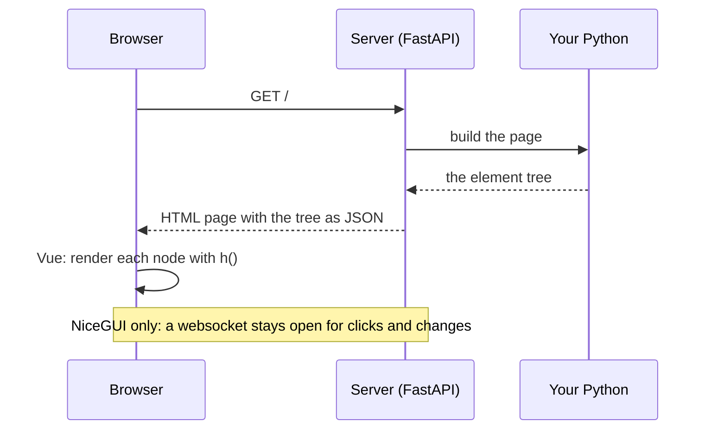

# The whole road

What happens when the browser opens the NiceGUI column or the mini NiceGUI. The two only differ at the
end: NiceGUI keeps a websocket open, so Python can change the page later (section 3).

The mini NiceGUI's tree is nested. NiceGUI sends a flat, numbered list instead (step 2.1), so it can
change one element later by its number, without sending the whole tree again.
