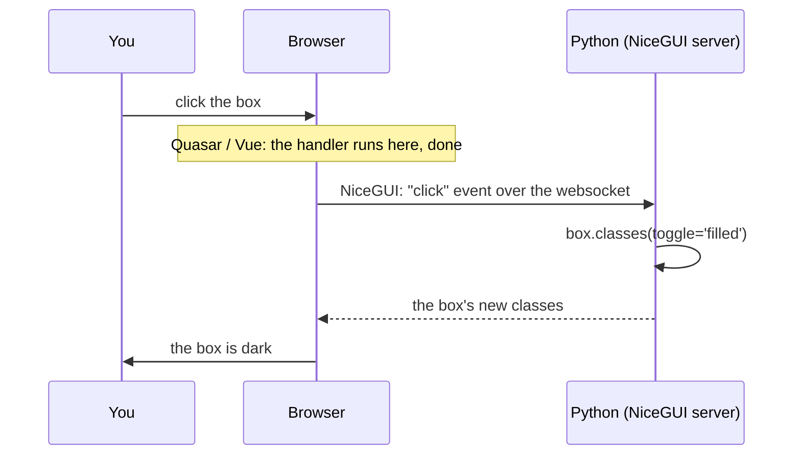

# A click's round trip

In Quasar and Vue, a click never leaves the browser. In NiceGUI it makes a round trip to your Python
and back. It is quick enough that you do not notice, and it means your click handler can use anything
Python can: files, a database, other libraries.



The handler is a normal Python function. A `lambda` is short for one line; a longer one looks like this:

```python title="nicegui_app.py, written with def"
def toggle():
    box.classes(toggle='filled')


box.on('click', toggle)
```
