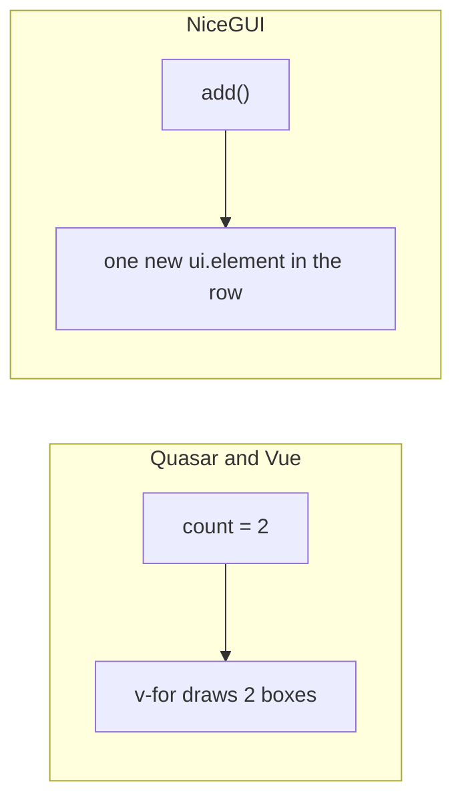

# Two ways to change a page

**Describe it** (Quasar and Vue): you keep data, like `count`, and say how the page looks for that data
(`v-for="n in count"`). Change the data, and Vue works out what to add or remove.

**Change it** (NiceGUI): you call Python that adds, moves or removes elements, like `add()`. NiceGUI
sends each change to the browser.



NiceGUI can describe too. `ui.refreshable` draws a part of the page again from your data, like `v-for`:

```python title="nicegui_app.py, written with @ui.refreshable (tested with NiceGUI 4.0.0)"
def root():
    count = 1

    @ui.refreshable
    def boxes():
        with ui.row():
            for _ in range(count):
                ui.element('div').style(BOX).on('click', more)

    def more():
        nonlocal count
        count += 1
        boxes.refresh()

    boxes()
```
